# Лабораторна робота №4 — звіт

## Загальна інформація

- **ПІБ:** Грицюк Назар Олександрович
- **Група:** ІПЗ-22
- **Роль у команді:** Developer
- **GitHub-акаунт:** [SkyDreammer-exe](https://github.com/SkyDreammer-exe)
- **Склад команди:**
  - Шульга Андрій Сергійович (Teamlead) — `shulgaaa294-stack`
  - Грицюк Назар Олександрович (Developer) — `SkyDreammer-exe`
  - Смоляр Орест Миколайович (QA) — `Mphizard`
- **Тема проєкту:** інтернет-магазин комп’ютерної техніки AVANGARD SHOP на Flask і SQLite
- **Репозиторій:** <https://github.com/The-Avangard/Lab-04>

## Особистий внесок у командну роботу

- реалізував маршрути каталогу, кошика та оформлення замовлення;
- оновив каталог і сторінки категорій, додав категорію приставок;
- працював над головною сторінкою, шапкою та стилями магазину;
- інтегрував маршрути в застосунок і перейменував вкладку контактів на «Зворотний зв’язок»;
- додав товари-приставки до каталогу та підготував скриншоти сторінок для звіту.

### Мої коміти

| Хеш | Дата | Опис |
|---|---|---|
| [`34f17c7`](https://github.com/The-Avangard/Lab-04/commit/34f17c759a999b19ed9ac8045db8de2abba582a7) | 08.11.2026 | Додано маршрути магазину та кошика |
| [`d624266`](https://github.com/The-Avangard/Lab-04/commit/d624266464dd1d4d44162283508b1d727313c6d3) | 08.11.2026 | Додано сторінку кошика |
| [`e98cad9`](https://github.com/The-Avangard/Lab-04/commit/e98cad950858ca1cc95133994d271ae6c8c30e9d) | 08.11.2026 | Оновлено каталог товарів |
| [`c214fd2`](https://github.com/The-Avangard/Lab-04/commit/c214fd28cee11fd77179bf1d8913f42aa2267e5c) | 08.11.2026 | Додано категорію приставок |
| [`c5da7a3`](https://github.com/The-Avangard/Lab-04/commit/c5da7a32c9d9102dc5434168ce63310b9dcee710) | 08.11.2026 | Оновлено інтерфейс сайту |
| [`17deb55`](https://github.com/The-Avangard/Lab-04/commit/17deb55016dc153a47aeb00e0321b47b2539964a) | 08.11.2026 | Підключено маршрути Lab 04 |
| [`df7b35b`](https://github.com/The-Avangard/Lab-04/commit/df7b35b2f40dcee568ecf4faa81ef135b8be150b) | 15.11.2026 | Перейменовано вкладку зворотного зв’язку |
| [`8362cfa`](https://github.com/The-Avangard/Lab-04/commit/8362cfaf87c2220d5dad1f9014c1a54ad4461248) | 15.11.2026 | Додано товари-приставки |
| [`48907dc`](https://github.com/The-Avangard/Lab-04/commit/48907dcf588225a3bdc5327b407bebc1e89b56a6) | 15.11.2026 | Оновлено скриншоти сайту |

## Реалізована функціональність

У проєкті використовується SQLite. Дані розділені між таблицями `clients`, `feedback`, `products`, `orders`, `order_items` і `promo_codes`. Для каталогу зроблено пошук і фільтрацію за категоріями «Ноутбук», «Стаціонарний ПК» та «Приставка». Кошик зберігається в сесії, а замовлення й позиції товарів створюються в базі даних.

## Схема бази даних

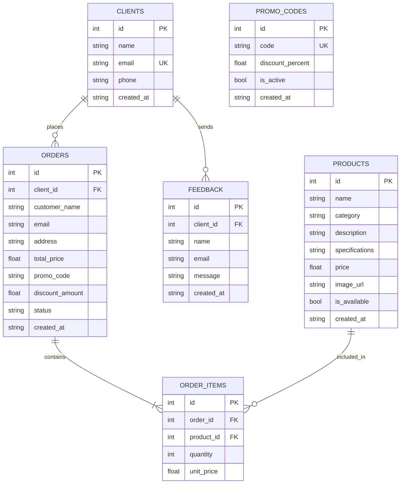

Таблиці `orders` і `products` пов’язані «багато-до-багатьох» через `order_items`. У таблиці позицій зберігається ціна товару на момент замовлення. Клієнти пов’язуються із замовленнями та відгуками за зовнішніми ключами. Запити до бази параметризовані, а перевірка зовнішніх ключів SQLite вмикається під час підключення.

## Скріншоти створених сторінок

### Головна сторінка

| Звичайний вигляд | Мобільний вигляд |
|---|---|
| 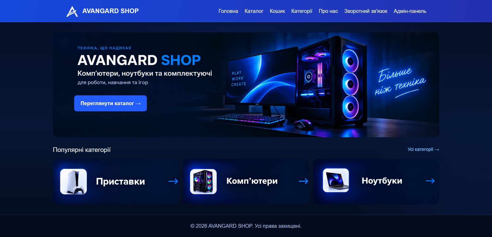 | 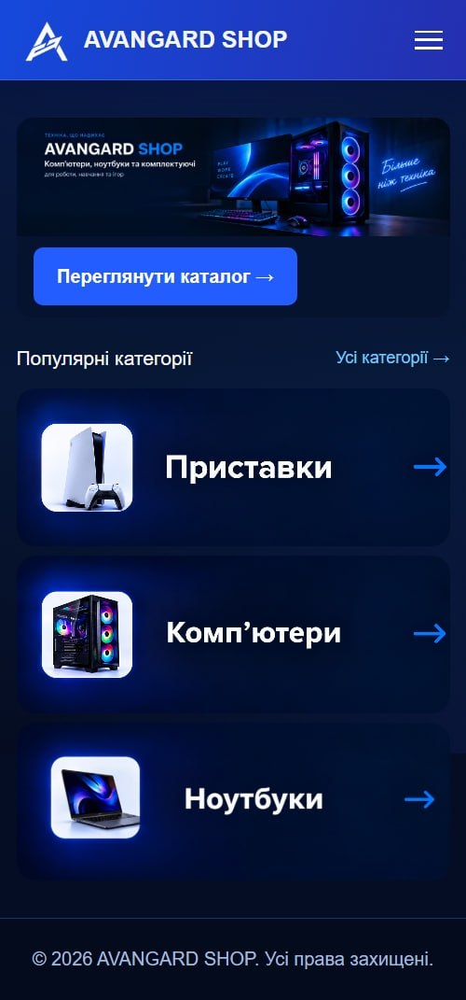 |

### Каталог

| Звичайний вигляд | Мобільний вигляд |
|---|---|
| 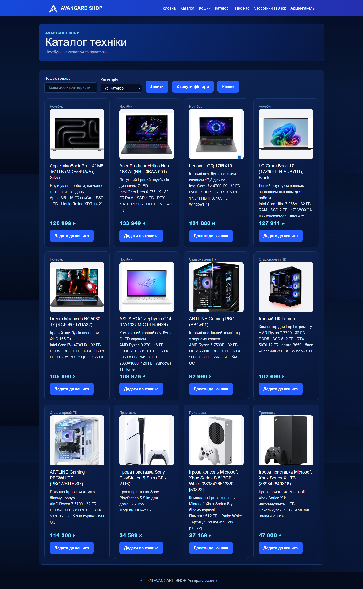 |  |

### Категорії

| Звичайний вигляд | Мобільний вигляд |
|---|---|
| 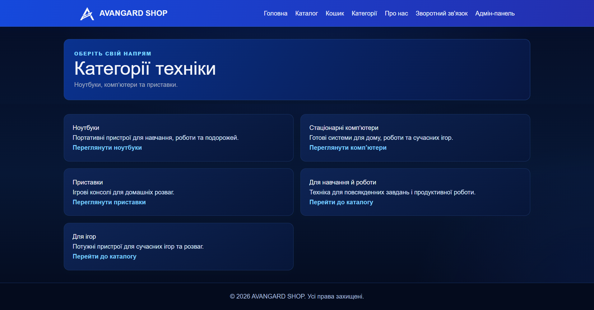 | 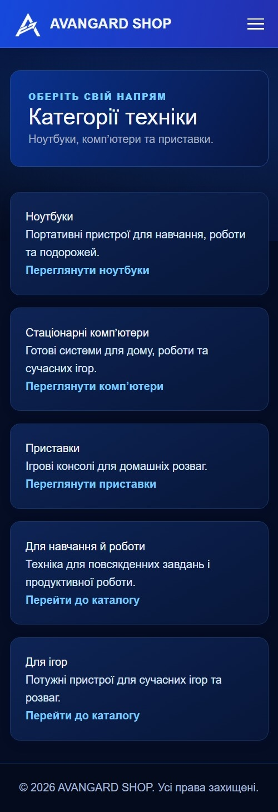 |

### Про магазин

| Звичайний вигляд | Мобільний вигляд |
|---|---|
| 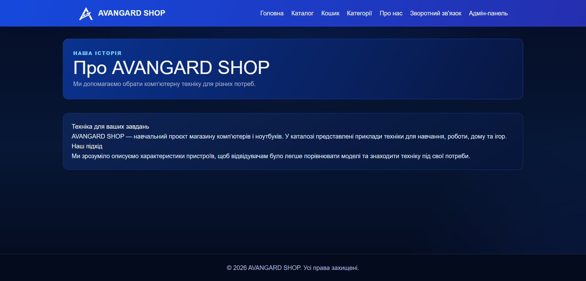 | 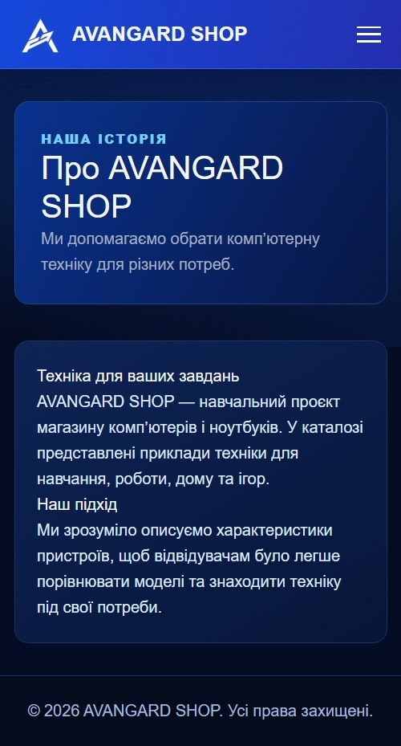 |

### Зворотний зв’язок

| Звичайний вигляд | Мобільний вигляд |
|---|---|
| 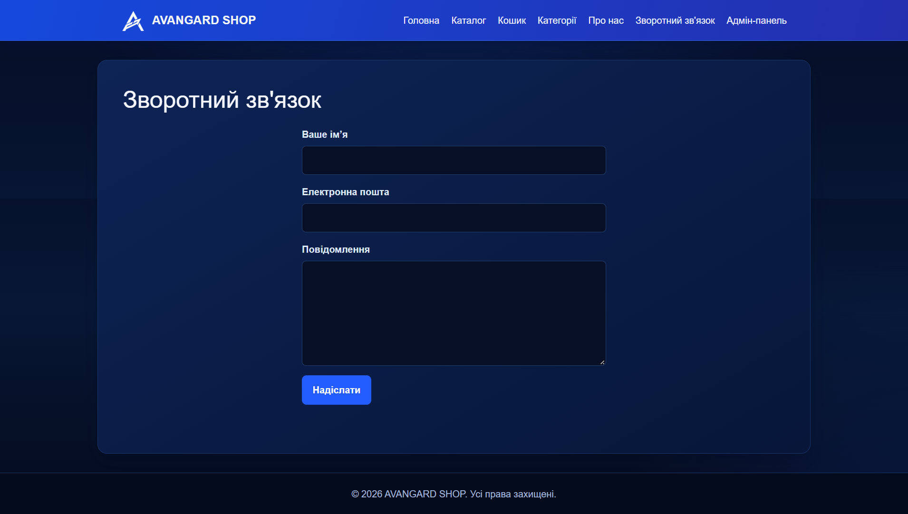 | 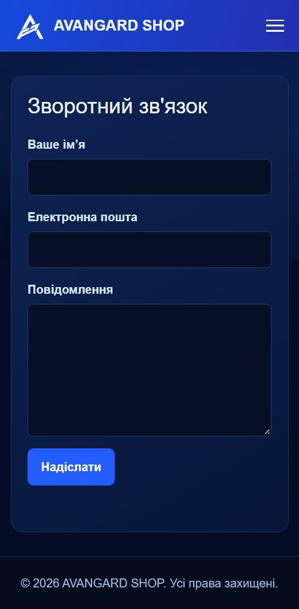 |

### Адмін-панель

| Звичайний вигляд | Мобільний вигляд |
|---|---|
| 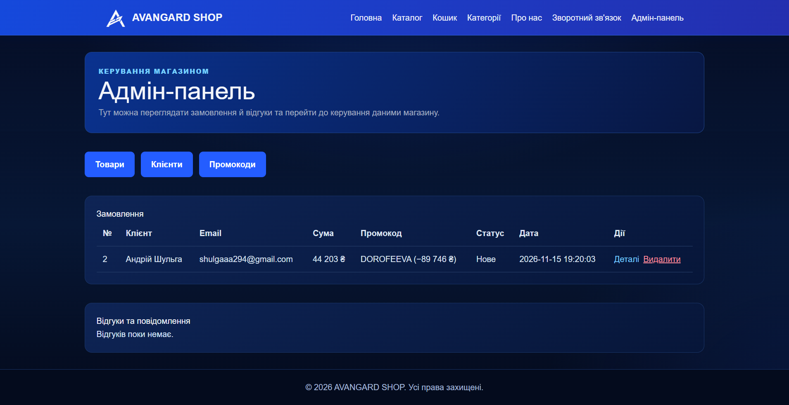 | 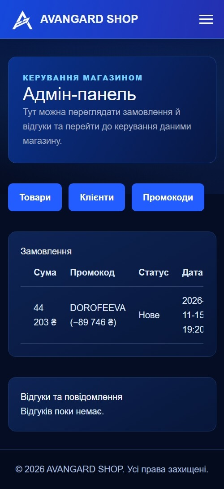 |

## Труднощі та їх вирішення

Під час об’єднання сторінок із Flask-маршрутами виникали помилки через невідповідність endpoint-ів у `url_for`. Перевірили назви blueprint-ів і маршрутів у шаблонах. Також узгодили значення категорій у формах, маршрутах і базі даних, щоб фільтр каталогу та додавання товарів використовували однакові назви.

## Висновки

Під час лабораторної роботи я працював над каталогом, кошиком, оформленням замовлення та інтерфейсом AVANGARD SHOP. На практиці закріпив роботу з Flask-маршрутами, сесіями та SQLite, а також командну роботу через GitHub.
