# Лабораторна робота №4 — звіт

## Загальна інформація

- **ПІБ:** Шульга Андрій Сергійович
- **Група:** ІПЗ-22
- **Роль у команді:** Teamlead
- **GitHub-акаунт:** [shulgaaa294-stack](https://github.com/shulgaaa294-stack)
- **Склад команди:**
  - Шульга Андрій Сергійович (Teamlead) — `shulgaaa294-stack`
  - Грицюк Назар Олександрович (Developer) — `SkyDreammer-exe`
  - Смоляр Орест Миколайович (QA) — `Mphizard`
- **Тема проєкту:** інтернет-магазин комп’ютерної техніки AVANGARD SHOP на Flask і SQLite
- **Репозиторій:** <https://github.com/The-Avangard/Lab-04>

## Особистий внесок у командну роботу

- розробив модель SQLite та функції доступу до даних магазину;
- додав маршрути адмін-панелі для замовлень, товарів, клієнтів, відгуків і промокодів;
- створив шаблони керування клієнтами та промокодами;
- додав форму введення промокоду під час оформлення замовлення;
- координував інтеграцію змін команди в спільний проєкт.

### Мої коміти

| Хеш | Дата | Опис |
|---|---|---|
| [`2adf7d3`](https://github.com/The-Avangard/Lab-04/commit/2adf7d3c85aca8e7f31971863c3cccd74c5a52d5) | 08.11.2026 | Додано модуль моделей SQLite для магазину |
| [`0ac4e50`](https://github.com/The-Avangard/Lab-04/commit/0ac4e50318bd4185434b5f7dd56205b184a60a94) | 08.11.2026 | Оновлено models.py |
| [`cf9c080`](https://github.com/The-Avangard/Lab-04/commit/cf9c0801d5af37bdb8852cbf69fb41148db0b14e) | 08.11.2026 | Додано маршрути адмін-панелі |
| [`6ee5762`](https://github.com/The-Avangard/Lab-04/commit/6ee5762782b10753b05110c3b8abb5bd959fe8b7) | 08.11.2026 | Додано сторінку керування клієнтами |
| [`4cfbe2e`](https://github.com/The-Avangard/Lab-04/commit/4cfbe2e372c2496d4e7f4557d62453f5875ac36c) | 08.11.2026 | Додано сторінку керування промокодами |
| [`429a65b`](https://github.com/The-Avangard/Lab-04/commit/429a65b9c60dc6a2e0b99a85528d5a577c8f55d8) | 08.11.2026 | Додано форму промокоду |

## Реалізована функціональність

У проєкті використовується SQLite. Реалізовано таблиці клієнтів, відгуків, товарів, замовлень, позицій замовлення та промокодів. Адмін-панель дає змогу переглядати й видаляти замовлення та відгуки, редагувати статуси замовлень і виконувати CRUD-операції для товарів, клієнтів і промокодів. У магазині є кошик, пошук товарів, фільтрація за категоріями та знижки за промокодами.

## Схема бази даних

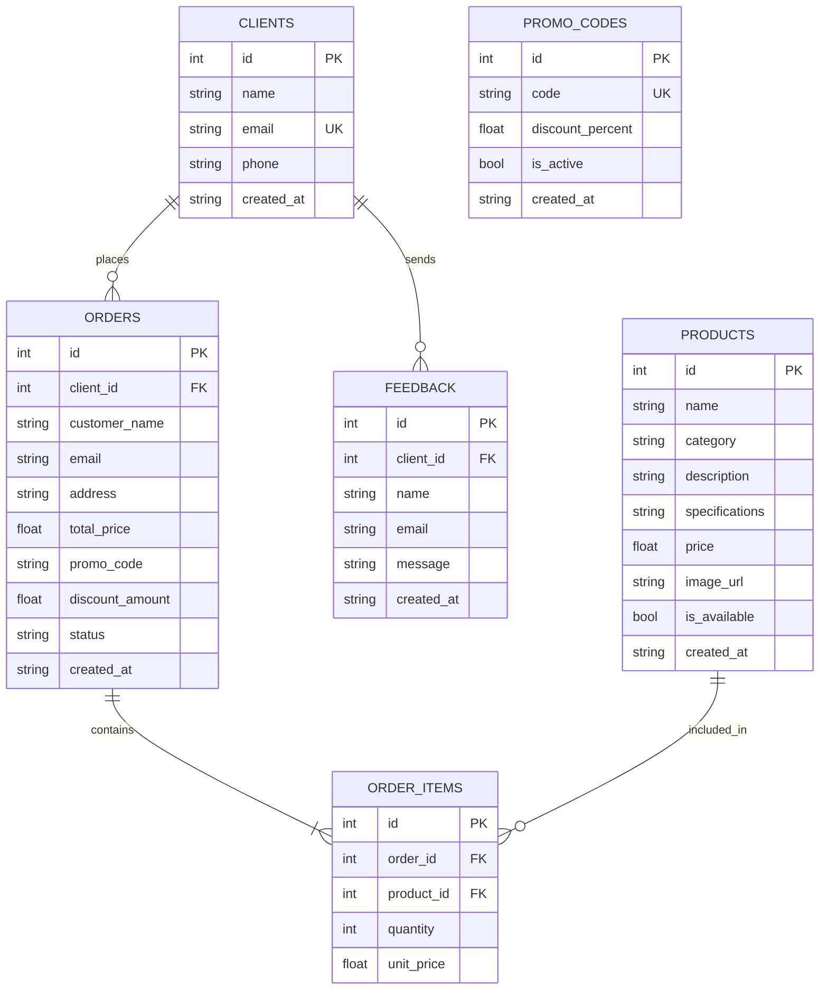

Таблиці `orders` і `products` пов’язані через `order_items`, що реалізує зв’язок «багато-до-багатьох». `order_items.unit_price` зберігає ціну на момент покупки. Клієнт може мати багато замовлень і відгуків. У таблиці замовлень зберігаються застосований промокод і сума знижки. SQL-запити параметризовані, а зовнішні ключі SQLite ввімкнені.

## Скріншоти створених сторінок

### Головна сторінка

| Звичайний вигляд | Мобільний вигляд |
|---|---|
| 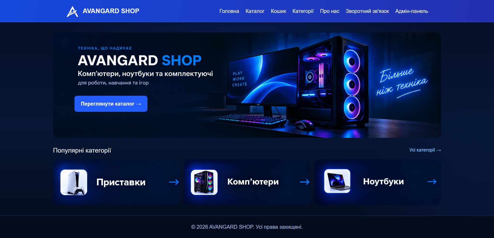 |  |

### Каталог

| Звичайний вигляд | Мобільний вигляд |
|---|---|
| 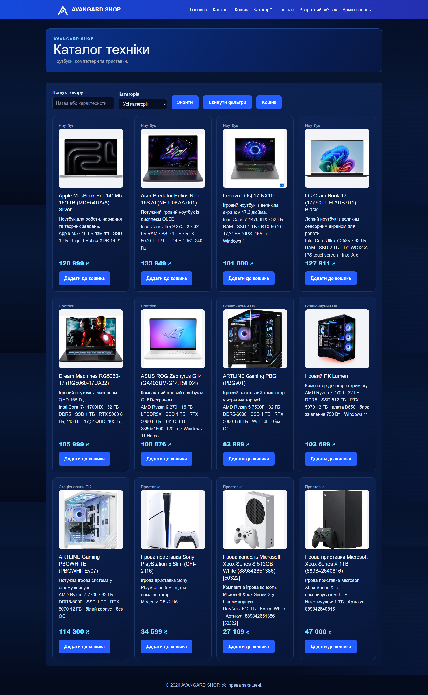 |  |

### Категорії

| Звичайний вигляд | Мобільний вигляд |
|---|---|
| 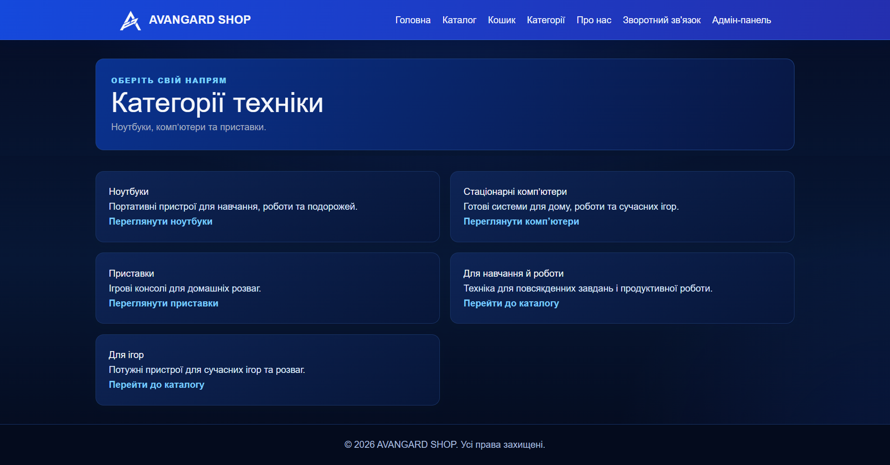 | 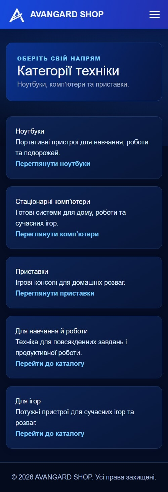 |

### Про магазин

| Звичайний вигляд | Мобільний вигляд |
|---|---|
| 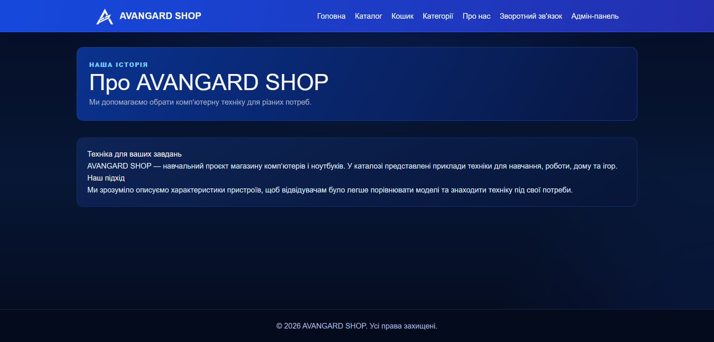 | 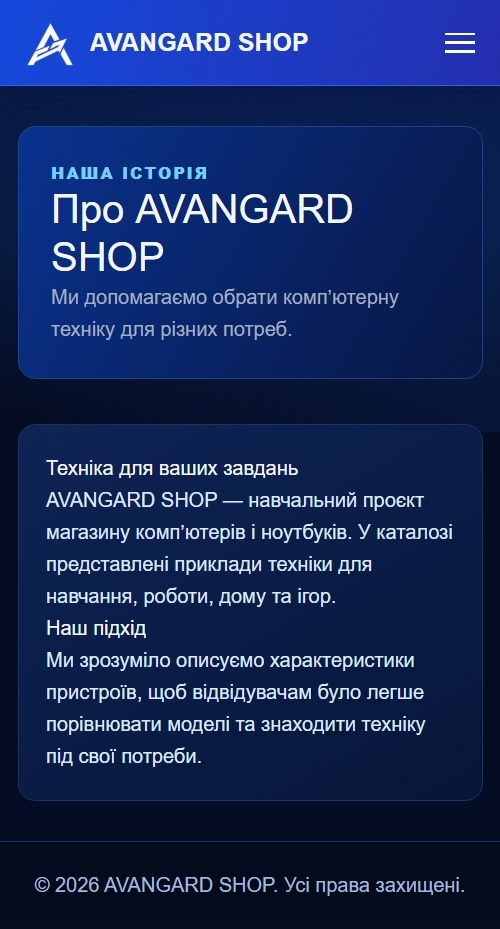 |

### Зворотний зв’язок

| Звичайний вигляд | Мобільний вигляд |
|---|---|
| 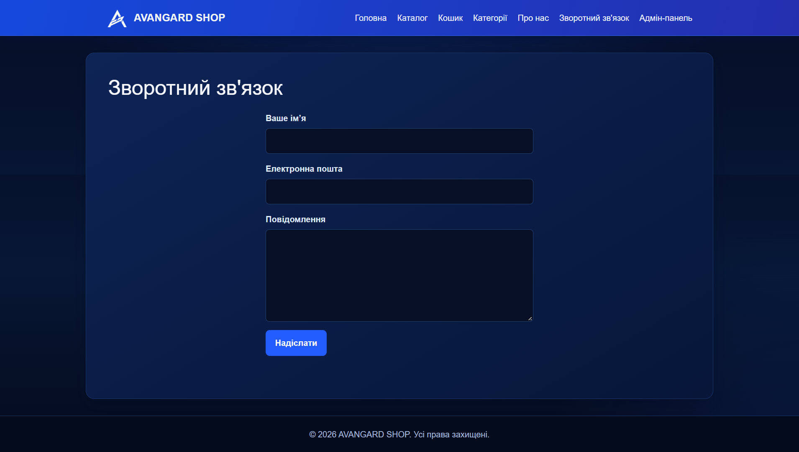 | 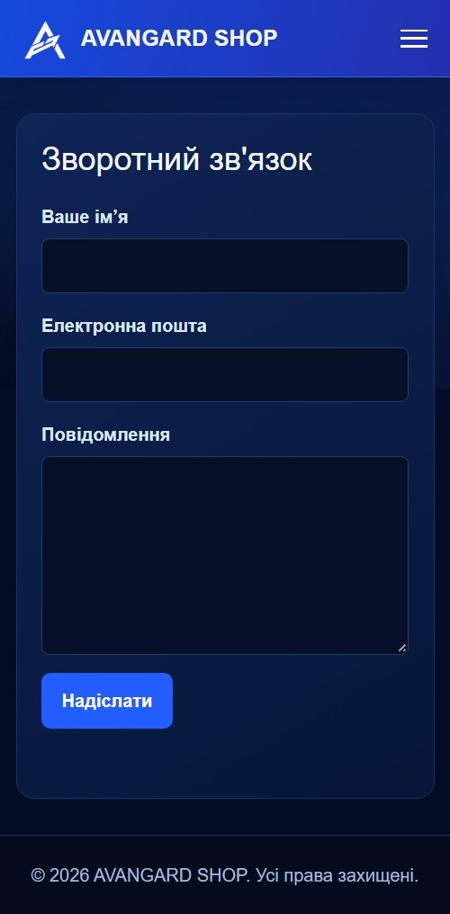 |

### Адмін-панель

| Звичайний вигляд | Мобільний вигляд |
|---|---|
| 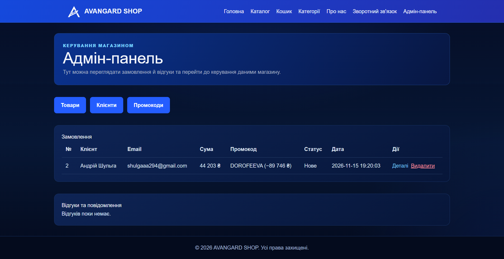 | 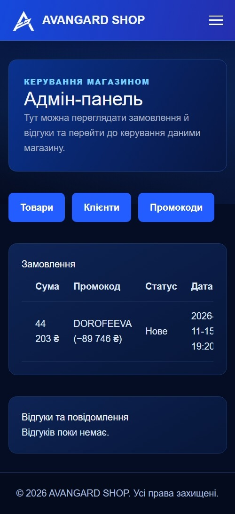 |

## Труднощі та їх вирішення

Під час розробки потрібно було спроєктувати зв’язок «багато-до-багатьох» між замовленнями й товарами та зберігати ціну товару на момент покупки. Для цього створили проміжну таблицю `order_items` із зовнішніми ключами та полем `unit_price`. Для цілісності даних увімкнули перевірку зовнішніх ключів SQLite.

## Висновки

Під час роботи я спроєктував структуру бази даних і розширив адмін-панель магазину. Закріпив практичні навички SQLite, Flask і побудови зв’язків між таблицями, а також координував об’єднання командних змін.