# Лабораторна робота №4 — звіт

## Загальна інформація

- **ПІБ:** Смоляр Орест Миколайович
- **Група:** ІПЗ-22
- **Роль у команді:** QA
- **GitHub-акаунт:** [Mphizard](https://github.com/Mphizard)
- **Склад команди:**
  - Шульга Андрій Сергійович (Teamlead) — `shulgaaa294-stack`
  - Грицюк Назар Олександрович (Developer) — `SkyDreammer-exe`
  - Смоляр Орест Миколайович (QA) — `Mphizard`
- **Тема проєкту:** інтернет-магазин комп’ютерної техніки AVANGARD SHOP на Flask і SQLite
- **Репозиторій:** <https://github.com/The-Avangard/Lab-04>

## Особистий внесок у командну роботу

- створив шаблони головної адмін-панелі, керування товарами та деталей замовлення;
- реалізував і виправляв шаблони форми зворотного зв’язку та її оброблення;
- підготував стилі для вкладки зворотного зв’язку;
- перевіряв сторінки та допомагав виправляти помилки шаблонів і форм.

### Мої коміти

| Хеш | Дата | Опис |
|---|---|---|
| [`7538622`](https://github.com/The-Avangard/Lab-04/commit/75386229da8bcdf51da1bf905239b1091628d9e0) | 08.11.2026 | Додано форму товару й сторінку керування товарами |
| [`a396ac8`](https://github.com/The-Avangard/Lab-04/commit/a396ac8c2cddfffe41327aee4d052354e0977079) | 08.11.2026 | Виправлено шаблони та форму відгуків |
| [`ee4a4cf`](https://github.com/The-Avangard/Lab-04/commit/ee4a4cfb2d59d706fa1572738e36abcff850cf28) | 15.11.2026 | Оновлено стиль вкладки зворотного зв’язку |

## Реалізована функціональність

Сайт AVANGARD SHOP працює на Flask і SQLite. Користувач може переглядати каталог, додавати товари до кошика, оформлювати замовлення та надсилати відгук. В адмін-панелі є список замовлень і відгуків, деталі замовлення, керування товарами, клієнтами й промокодами. Для замовлення можна змінити статус.

## Схема бази даних

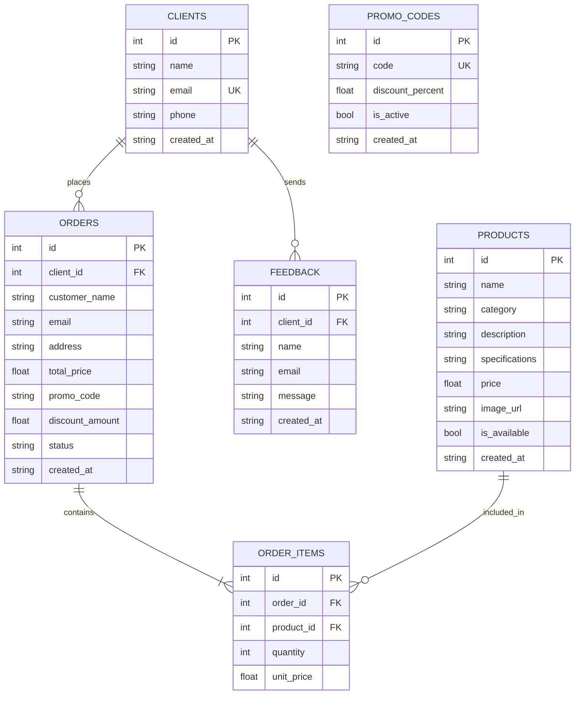

Таблиці `orders` і `products` з’єднані проміжною таблицею `order_items`. Вона зберігає товар, кількість і ціну на момент оформлення. Таблиця `clients` пов’язана із замовленнями й відгуками. Дані форм перевіряються на сервері, а значення передаються до SQL-запитів як параметри.

## Скріншоти створених сторінок

### Головна сторінка

| Звичайний вигляд | Мобільний вигляд |
|---|---|
| 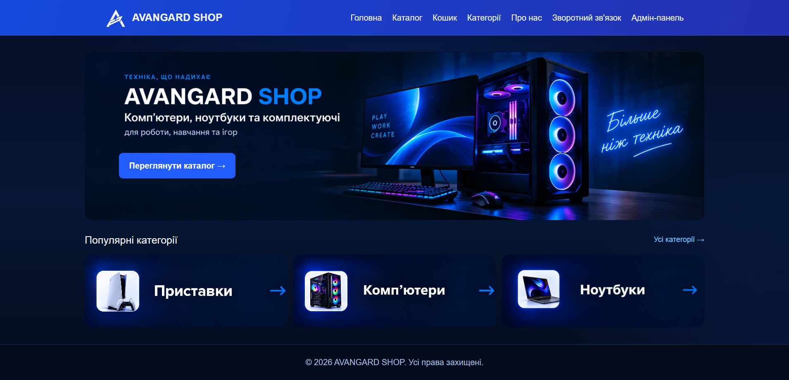 |  |

### Каталог

| Звичайний вигляд | Мобільний вигляд |
|---|---|
| 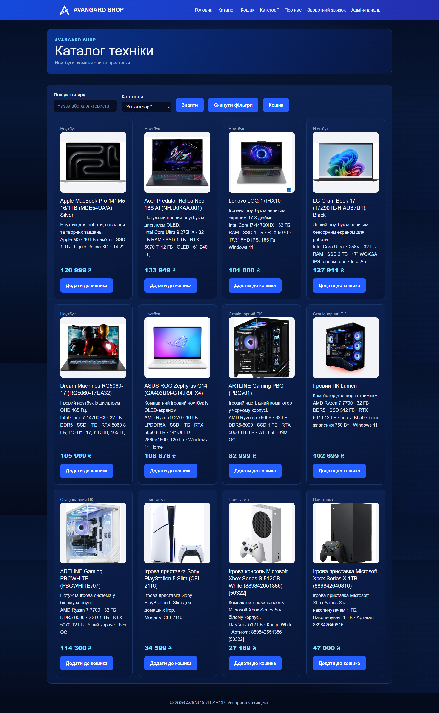 |  |

### Категорії

| Звичайний вигляд | Мобільний вигляд |
|---|---|
| 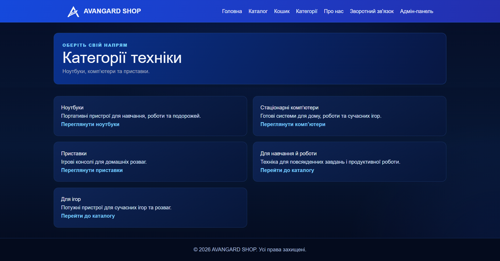 | 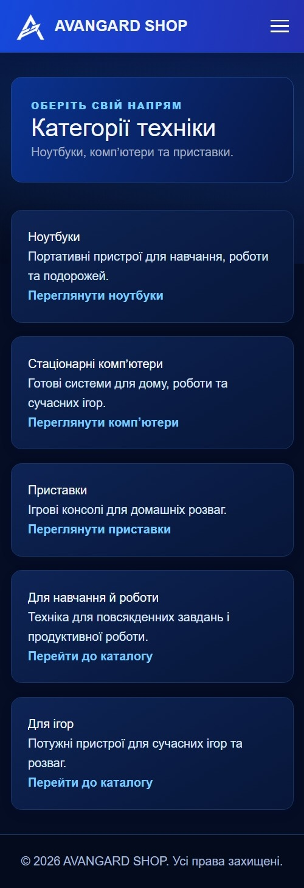 |

### Про магазин

| Звичайний вигляд | Мобільний вигляд |
|---|---|
| 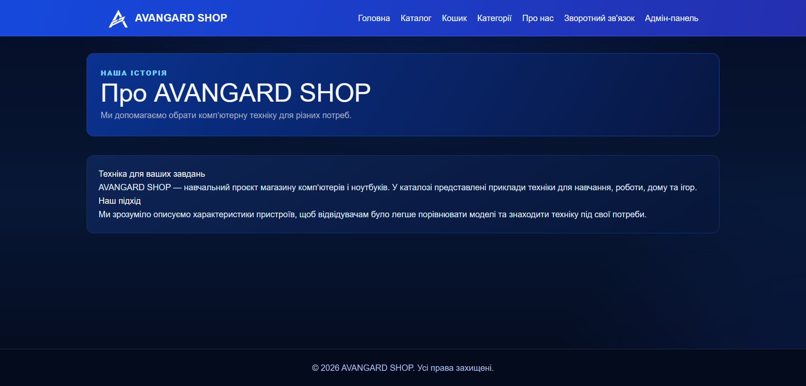 | 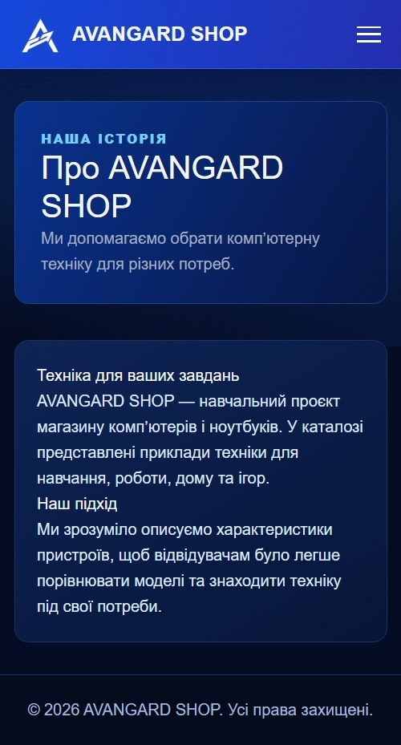 |

### Зворотний зв’язок

| Звичайний вигляд | Мобільний вигляд |
|---|---|
| 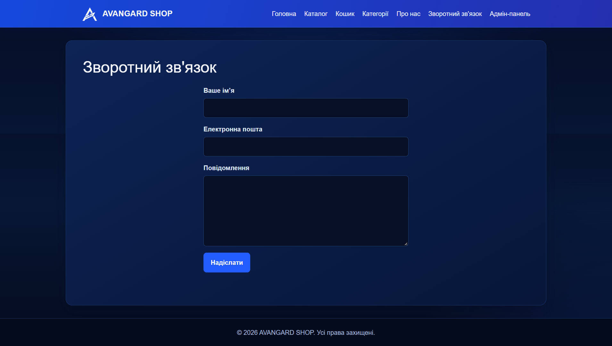 | 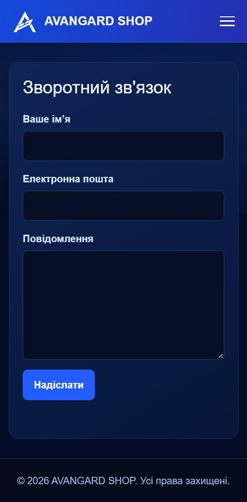 |

### Адмін-панель

| Звичайний вигляд | Мобільний вигляд |
|---|---|
| 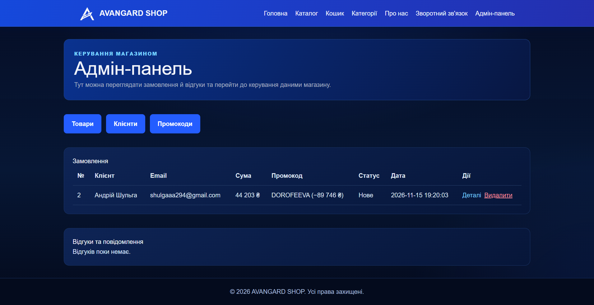 | 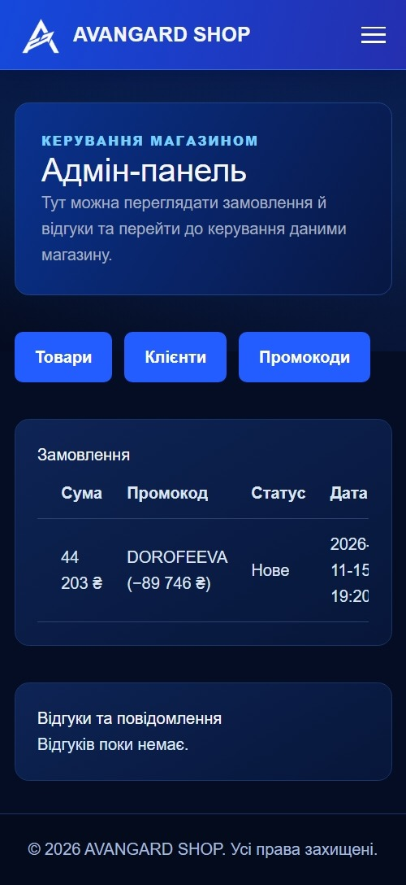 |

## Труднощі та їх вирішення

Під час роботи з формами важливо було узгодити HTML-поля, серверну перевірку та назви маршрутів у шаблонах. Перевірили `url_for` і оброблення даних у Flask-маршрутах, виправили помилки шаблонів та додали серверну валідацію полів форми зворотного зв’язку.

## Висновки

Під час лабораторної роботи я створив і перевірив сторінки адмін-панелі, замовлень і зворотного зв’язку. Закріпив навички роботи з Flask-шаблонами, формами та інтеграції користувацького інтерфейсу з маршрутами застосунку.